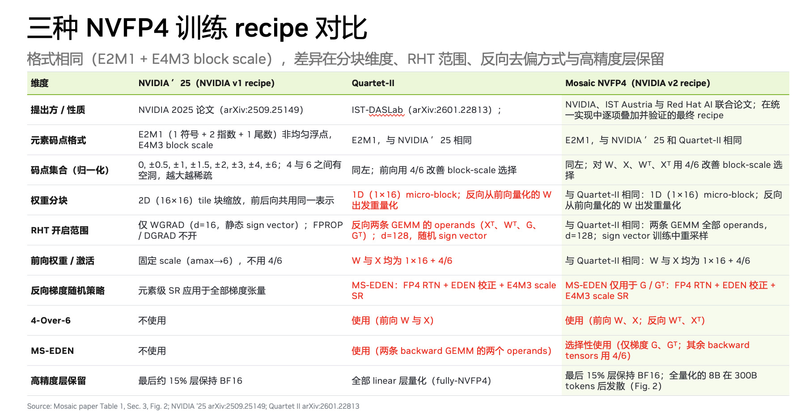

# 【外部合作】NV 技术方案进展对齐（KDA 训推一致、Zero-CTA、Megatron Lite、NVFP4）

### TODO 清单

| # | 待办事项 | 跟进人 | 说明 |
|---|----------|--------|------|
| 1 | 共同评审 FP32 state KDA 实现，推进训练侧 CP128 适配 | NV / MT | 适配后参考 K3.1 混合注意力架构做端到端性能评估 |
| 2 | 确认 Driver 从 580 + patch 升级到 620 的必要性，补充技术说明 | NV / MT | 与网络组核实功能支持和算子性能收益 |
| 3 | 阅读 Megatron Lite 的 Skill 和 verl 接入文档，评估迁移工作量 | MT | 源码和接入文档已同步 |
| 4 | 查看 Hopper FP8 forward/backward 实现，与 MT Hopper mok 版本对比 | NV / MT | 代码已同步到 MegaMoE 私有仓库，性能对比待开展 |
| 5 | 组织 FP4 训练方案线下交流 | NV / MT | 暂定 12 月中旬在北京，拟由 NV 分享 |
| 6 | 补充 RL 场景下 INT8 / FP8 KV Cache 的选型依据 | NV | 提供业界实践或调研结论 |
| 7 | 同步 Graph Node 过多问题的 Driver 修复版本 | NV | MT 已有 workaround，NV 会上表示已有修复版本，待群内同步 |

---

### KDA 训推一致（FP32 state / CP128）

延续 10 月 27 日的 KDA 训推一致议题。NV 展示了以 decode 为基准、让 prefill 向 decode 对齐的 FP32 state 方案，双方同意先评审实现并推进训练侧 CP 适配。

- 会后同步的 [zero-mismatch-rl PR #3](https://github.com/Inferact/zero-mismatch-rl/pull/3) 已合并，为 Kimi K3 / K3.1 新增 batch-invariant KDA 前向 kernel。Prefill 和 decode 使用相同顺序的 FP32 recurrence，在同一软硬件栈上验证了 bitwise 一致。PR 中用于对照的 FlashInfer decode 路径使用 BF16 state。
- PR 的 B300 算子测试中，带 accepted-state commit 的 Q4 / Q6 / Q8 decode 延迟为 FlashInfer 的 **1.02～1.11×**。Chunk prefill、prefill 和 192K forward 延迟分别为对应 FlashKDA 基线的 **2.38×、2.86×、1.59×**。Model runner 和 speculative decoding 的集成需单独推进。
- MT 训练侧当前需要 **CP128**，推理侧 prefill / decode 可走 TP。会上还讨论了 **512K prefill** 的场景和 **1M 序列下的 CP256** 目标。CP128 是当前适配项。
- MT 希望尽量保住训练和 prefill 性能，可接受 decode 单算子有一定回退，最终看端到端是否显著变慢。NV 初版优先控制异步 RL 关键路径上的推理耗时。双方约定在 CP 适配后，参考 Kimi K3.1 的混合注意力架构做端到端对比。

### FSDP Reduce-Scatter / Zero-CTA 与 Driver

延续 10 月 27 日的 Reduce-Scatter SM 占用问题。

- 会上同步，在 **Driver 580 + patch** 的 64 卡测试中，结合 **Copy Engine（CE）** 并选用 **symk kernel**，Reduce-Scatter 的 SM 占用由约 **32 个降至 4 个**，性能与标准方案相当。更大规模的验证待开展。
- 当前 patch 用于启用相关扩展能力。请 NV 与网络组确认是否建议升级到 **620**，并说明功能支持和是否有额外的算子性能收益。

### Agent Native 训练框架（Megatron Lite）

- NV 介绍了 Megatron Lite 的拆分方式。分布式、优化器等通用能力与模型实现解耦，模型代码按目录维护，便于 Agent 和开发者定位、修改和验证。
- verl 已提供训练接入预览，包含 DeepSeek-V4 的 SFT / GRPO 示例。文档中上游预期名称为 **Megatron Agent Compose**，预览实现仍使用 `mlite` 等命名。
- NV 在会上分享了 Skill。RL 训推一致验证要求 bitwise 对齐，预训练验证则会比较 forward 和梯度的 cosine similarity，并用相同数据对比 loss、grad norm 曲线。MT 后续研究精度验证和新模型接入流程，再评估迁移可行性。
- 参考资料：[NVIDIA Megatron Lite 源码](https://github.com/NVIDIA/Megatron-LM/tree/dev/experimental/lite) · [verl 接入文档](https://verl.readthedocs.io/en/latest/advance/megatron_lite_backend.html)

### MegaMoE Hopper FP8 实现进展

- 群内已同步 **Hopper FP8 forward & backward** 代码，位于 MegaMoE 私有仓库 [cutedsl_megamoe_mxfp8](https://github.com/MinaHuai/cutedsl_megamoe_mxfp8/tree/main)。对应 8 月的 Hopper 实现待办，以及 10 月提出的 Hopper CuTe DSL 与 MT mok 对比事项。
- MT 侧可查看实现和接入方式，后续沿用 10 月对齐的单节点基准参数做性能对比。

### NVFP4 V2 预训练（Mosaic NVFP4）

- 群内补充了 [NVFP4 V2 论文](https://arxiv.org/abs/2610.24343)。在 **1T tokens** 预训练结束时，Mosaic 相对 **BF16** 的 train-loss gap 在 **30B-A3B MoE** 上低于 **0.81%**，在 **8B dense** 上低于 **1.2%**，较 NVIDIA ’25 NVFP4 recipe 分别缩小 **0.36** 和 **0.24 个百分点**。所测下游任务得分与 v1 整体接近，个别任务有升有降。
- 对比图整理了 NVIDIA ’25、Quartet-II 和 Mosaic 三种 recipe。三者均采用 **E2M1 + E4M3 block scale**。Mosaic 采用 **1×16 权重分块**、对梯度选择性使用 **MS-EDEN**，论文的两组 1T-token 实验均将最后 **15%** 的网络保留为 BF16。
- NV 在会上提到，其小规模实验也观察到 V2 的 loss gap 有所缩小。MT 对 **NVFP4 / MXFP4** 暂未选型，拟于 **12 月中旬在北京**线下交流训练方案。

### RL 场景下 KV Cache 精度（INT8 / FP8）

- MT 观察到部分场景下 KV Cache 的数值分布较均匀，提出 INT8 可能更合适。NV 在会上提到 FP8 的应用更广，并举了 DeepSeek V4 和 Qwen 的例子。
- 选型仍待确认。请 NV 补充 INT8 / FP8 在 KV Cache 上的数值表示依据、业界实践或调研结论。
